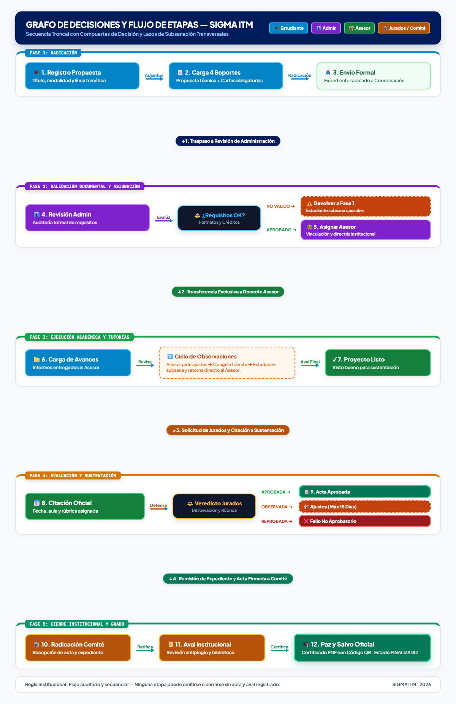
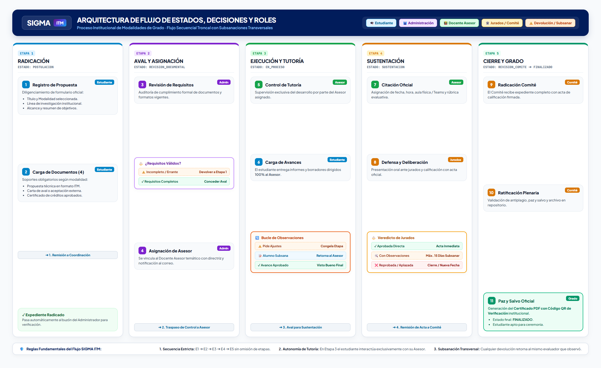

# Diagrama de Flujo e Interacciones de las 5 Etapas — SIGMA ITM

Este documento describe con exactitud el ciclo de vida completo de un trabajo de grado en la plataforma **SIGMA ITM**, los roles institucionales autorizados en cada fase, las compuertas de decisión técnica y el flujo de los documentos y subsanaciones.

---

## 1. Grafo de Decisiones y Flujo por Etapas (Vista Oficial en Alta Definición)

Mapa relacional y secuencial de las **5 Etapas**, ilustrando las compuertas de validación técnica, los responsables institucionales y los lazos de retorno por subsanación:

> [!TIP]
> **Acceso al archivo original en alta resolución:**  
> [🔗 Abrir Imagen 1: `grafo_flujo_vertical.png` en Pantalla Completa](file:///c:/Users/liba-/OneDrive/Escritorio/1.0ITM_2026-2/Proyecto%20jorge/sigma-itm-skeleton/sigma-itm/docs/img/grafo_flujo_vertical.png)

---

## 2. Infografía de Arquitectura de las 5 Etapas (Fondo Claro Panorámico)

Estructura detallada de las 5 Etapas con desglose de formularios, acciones por rol institucional, expedientes y resultados de grado:

> [!TIP]
> **Acceso al archivo original en alta resolución:**  
> [🔗 Abrir Imagen 2: `flujo_proceso_sigma_itm.png` en Pantalla Completa](file:///c:/Users/liba-/OneDrive/Escritorio/1.0ITM_2026-2/Proyecto%20jorge/sigma-itm-skeleton/sigma-itm/docs/img/flujo_proceso_sigma_itm.png)

---

## 3. Matriz de Destinatarios y Flujo Documental

Cuando el estudiante sube o anexa un documento a su expediente institucional, la plataforma SIGMA ITM resuelve automáticamente el destinatario legítimo y los permisos según la etapa activa:

| Etapa Activa | Código Estado Sistema | Actor Destinatario del Archivo | Potestad de Evaluación y Avance |
| :--- | :--- | :--- | :--- |
| **1. Radicación** | `POSTULACION` | **Coordinación / Administrador** | Administrador de Grados (Verifica que la propuesta y los anexos cumplan con los formatos vigentes). |
| **2. Aval Documental** | `REVISION_DOCUMENTAL` | **Administrador del Sistema** | Administrador (Otorga aval documental institucional y asigna al Docente Asesor oficial). |
| **3. Ejecución y Avances** | `EN_PROCESO` | **Docente Asesor Asignado** | **Únicamente el Docente Asesor**. El estudiante trabaja exclusivamente con su tutor temático sin intermediación administrativa. |
| **4. Sustentación** | `SUSTENTACION` | **Docente Asesor y Jurados** | Asesor cita a sustentación; Jurados Calificadores deliberan y califican con rúbrica institucional. |
| **5. Cierre y Grado** | `REVISION_COMITE` ➔ `FINALIZADO` | **Comité de Trabajos de Grado** | Comité Institucional de Grados (Audita paz y salvos, antiplagio, depósito en biblioteca y ratifica acta oficial). |

---

## 4. Las 3 Reglas de Oro del Sistema SIGMA ITM

1. **Secuencialidad Estricta e Inviolable:**
   * La progresión es lineal y jerárquica: `E1 ➔ E2 ➔ E3 ➔ E4 ➔ E5`. Ningún estudiante puede sustentar sin haber sido avalado por un asesor, ni remitirse a comité sin acta formal de sustentación.
2. **Autonomía Exclusiva de Tutoría en Etapa 3:**
   * Una vez el Administrador asigna el tutor, el proyecto sale del control administrativo. Todos los documentos, entregables, versiones de código y subsanaciones cargadas por el estudiante **llegan de manera directa y exclusiva al Docente Asesor**.
3. **Trazabilidad y Subsanación Transversal:**
   * En cualquiera de las fases (1 a 5), el evaluador competente puede ejecutar **"Pedir Corrección"**. El sistema congela el avance de la etapa, habilita el turno de edición/subsanación al estudiante con historial de observaciones, y una vez radicada la corrección, **el trámite retorna exactamente al mismo evaluador** que solicitó el ajuste.
